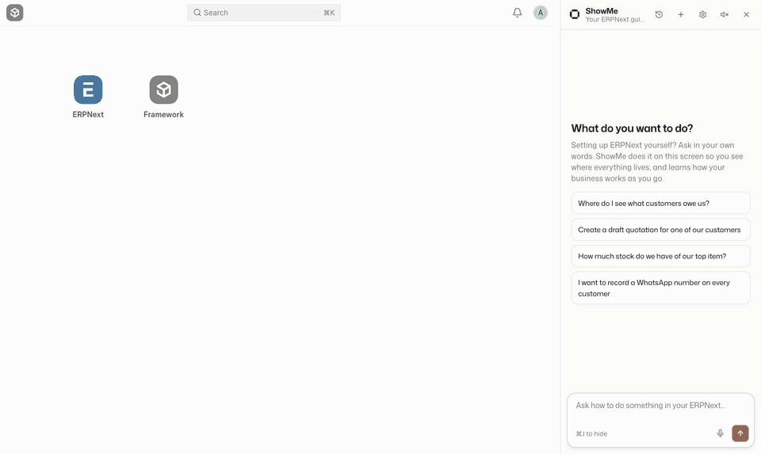
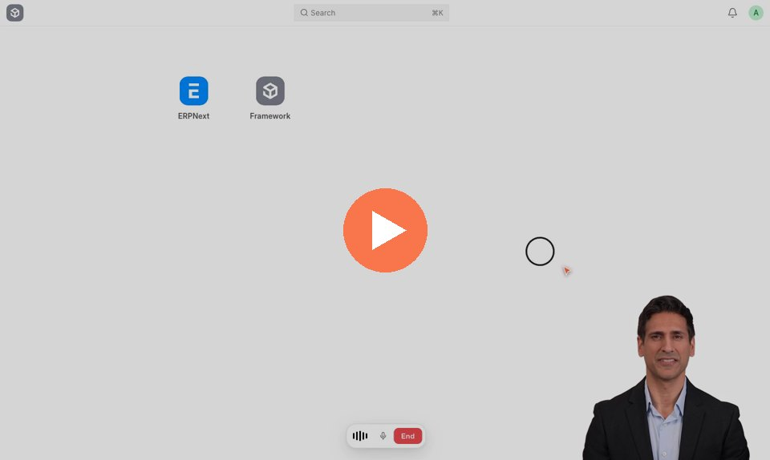

# ShowMe for ERPNext

**The AI guide for people self-implementing ERPNext.**

More and more businesses set up ERPNext themselves, often with AI doing the configuration. What gets lost is the
consultant who used to sit next to you and *show you around*: where things live, what your words are called in
the system, why a field matters. ShowMe is that walkthrough. Ask in your own words ("raise a purchase request for
100 kg of steel", "which customers owe us money?") and watch it happen on your screen: an animated cursor opens
the right page, fills the form and saves the draft, narrating as it goes. Over time it learns how *your* business
uses ERPNext.

It's a Chrome extension. It works with **any ERPNext you can open in Chrome** (Frappe Cloud, self-hosted,
localhost) without installing anything on the server, and runs on **your own API keys**.



<sub>Recorded on ERPNext's demo data with `scripts/record-demo.mjs`, in real time except that long unchanged stretches are shortened. That task cost 6¢.</sub>

**Voice:** talk to it like a colleague on a call. [▶ Watch a voice call](docs/voice-demo.mp4) (1:40, with sound)

[](docs/voice-demo.mp4)

<sub>The business owner is an AI avatar (made with Tavus) whose lines were played into the microphone. Everything
else is a real, unedited ShowMe voice call on ERPNext's demo data, recorded with `scripts/record-voice-demo.mjs`.</sub>

## What it does

- **Shows you, on your screen.** It uses ERPNext's own screens with a visible cursor, not hidden API calls, and
  finds pages the way you would (the search bar), so you learn where things live.
- **Speaks your language.** "Purchase request" becomes **Material Request**, "GRN" becomes **Purchase Receipt**,
  "godown" becomes **Warehouse**. It says the mapping once, then gets on with it.
- **Answers questions about your data.** It opens the relevant list or report, reads the numbers and states them.
- **Learns your setup, with your OK.** When you mention how your business does things ("we call these
  indents"), it offers to remember it. Nothing is saved until you press **Remember**.
- **Picks up where you left off.** Conversations are saved per site in your browser, with a History view.
- **Voice (optional).** Press the mic and it becomes a call: ShowMe says what it's about to do, then does it. Its
  words appear as subtitles at its cursor, yours as a ring around your own pointer, and the bar shrinks to mute and
  End. Uses OpenAI's GPT-Live; the mic appears once you add an OpenAI key.
- **Setup changes, with your approval (optional).** Custom fields, field rules, scripts, notifications,
  workflows. First it checks whether standard ERPNext already does what you want. Each change needs your Apply,
  is logged, can be undone, and is shown to you once applied.

## Why a bar, not a sidebar

ShowMe's job is to make you look at ERPNext, so it stays out of the way. There is no chat panel: a bar at the
bottom takes your question, a short label next to the cursor says what it is doing as it does it, and the answer
is one or two lines above the bar. **Full conversation** (or the ⌃ button) opens the whole thread when you want it.
Measured on the demo recording: the narration sits a median **23 px** from the cursor (a sidebar put it ~650 px
away), and ShowMe covers about **3%** of the screen while working (the sidebar covered 35%).

## Install

1. **Get the code:** `git clone https://github.com/CratorAI/showme-erpnext` (or download the ZIP and unzip it).
2. **Load it in Chrome:** open `chrome://extensions`, turn on **Developer mode** (top right), click **Load
   unpacked** and choose the `extension` folder.
3. **Add your keys:** click the ShowMe icon → **Settings, keys & skills**.
   - **Anthropic API key** (required), from [console.anthropic.com](https://console.anthropic.com).
   - **OpenAI API key** (optional, for voice), from [platform.openai.com](https://platform.openai.com).
4. **Turn it on for your site:** open your ERPNext, click the ShowMe icon → **Turn on for this site**.
   Chrome asks for permission for that site only.
5. Reload the page. A small ShowMe bar sits at the bottom of the desk: type what you want and press Enter.
   **⌘J / Ctrl+J** shows or hides it.

Works with ERPNext / Frappe v15 and v16 desks.

## Skills: teach it your setup

In settings, drop in `.md` files or paste them. Optional frontmatter, then anything you'd tell a new colleague:

```markdown
---
name: buying-process
description: How we buy raw material and who approves it
---

- "Indent" means Material Request. The store keeper raises them; POs over ₹50,000 need the director.
- Everything we buy lands in "Main Godown - AT". Never use "Stores - AT".
- Customer has a custom field `credit_days`; respect it in payment terms.
```

Each skill applies to all sites or to one site. Facts ShowMe learns in conversation (after you press Remember) go
into a `site-notes` skill you can edit or delete. See [`examples/skills`](examples/skills).

## Conversations and privacy

- Conversations are stored **only in this browser** (IndexedDB), per site. Never synced, never sent anywhere except
  to the model provider while you're using them. They can contain data from your ERPNext.
- History lets you resume, rename, pin, export (Markdown) or delete. Settings has a retention period (90 days by
  default; pinned conversations are kept) and delete-all.
- A new tab on the same site picks up your latest conversation if it's recent.

## Safety

It acts **as you, with your ERPNext permissions**, in your browser session. Recommended: try it on a test copy of
your site first, or log in as a user whose roles match what you want it to be able to touch.

- **Drafts only by default.** It saves drafts and asks before submitting. Clicking **Submit, Cancel, Delete or
  Amend** always shows an approval card first (you can turn this off in settings).
- **Setup changes are off by default.** When you turn them on, every change needs your Apply, is all-or-nothing,
  is listed in settings, and can be undone by asking ("undo that change").
- **Your keys** stay in this browser's extension storage and are sent only to `api.anthropic.com` /
  `api.openai.com`.
- **Only on sites you turn on.** The extension asks for permission per site.
- **Approval buttons only answer real clicks.** ShowMe's controls live in the page, so a page script could try to
  press Apply; only genuine user input counts.

Know the limits:

- **`run_js` can read, not write.** To read data and handle fiddly widgets, the model can run JavaScript in the
  page with Frappe's API. While its code runs, ShowMe refuses requests that would change data: the REST API's
  writes and Frappe methods named like a write (insert, save, submit, cancel, delete, set_value, rename, amend,
  `run_doc_method`, …). So changes go through the visible cursor and its approval cards. A custom server method
  that writes under some other name could still get through; Frappe's permissions apply either way.
- **Prompt injection.** The model reads what's on your screen. Text in your ERPNext (a customer name, a comment, an
  imported description) could try to give it instructions. Treat data from outside your business accordingly.

## How it works

```
 Your ERPNext tab                                            Extension service worker
 ┌──────────────────────────────────────────┐               ┌───────────────────────────────────────┐
 │ content.js                               │   messages    │ background.js                          │
 │  • bar, thread card, History, approvals  │◀─────────────▶│  • agent loop (agent.js) → Anthropic   │
 │  • "eyes": snapshot → "e12 textbox …"    │               │  • tools, approvals, change log        │
 │  • "hands": cursor + pointer/key events  │               │  • conversations (store.js, IndexedDB) │
 │  • voice: GPT-Live over WebRTC           │               │  • skills, prices, GPT-Live sessions   │
 └──────────────────────────────────────────┘               └───────────────────────────────────────┘
          ▲  Frappe's JS API (frappe, cur_frm) via chrome.scripting in the page's main world
```

- **Seeing:** the page is summarised as one line per visible control with a short ref, its label, field name
  and value. Much smaller than HTML, and enough to act on.
- **Acting:** an animated cursor glides to the element, then real-looking pointer, mouse and keyboard events fire,
  so Frappe's own handlers (autocomplete, grid editing, the router) react as they would to a person. For fiddly
  widgets and for reading data it uses Frappe's client API. Failed Frappe calls come back to the agent as errors
  instead of popping up on your screen.
- **Thinking:** a tool-use loop over the Messages API (Claude Sonnet by default) with prompt caching. The history
  is append-only: old screen readings are cleared **server-side** (context editing) and long conversations are
  condensed between tasks (on-demand compaction). The prompt and tools are fixed per conversation, which keeps the
  cache warm and the model's earlier reasoning valid; new settings and skills apply to new conversations.
- **Voice:** GPT-Live handles the conversation and hands each task to the agent (client delegation); the agent's
  narration flows back for it to say aloud.

## Costs

You pay your providers directly. ShowMe shows what each task cost under the answer
(e.g. `1.5¢ · 62k tokens · 97% cached · 2 steps`), with monthly totals per site in settings. Prices come from
[LiteLLM's price list](https://github.com/BerriAI/litellm), refreshed daily: an estimate, not your invoice.

Measured on Claude Sonnet 5.5 with `scripts/long-session.mjs` (30 questions in one conversation): **$0.80 in
total, 2.6¢ per question on average**, with a median **97% of the prompt served from cache**. Simple data questions
are often under 1¢; a question that opens a report or a long list costs 2–7¢.

Voice (GPT-Live) is billed per minute by OpenAI; ShowMe counts the minutes.

## Development

No build step: edit the files in `extension/` and click reload on `chrome://extensions`.

Tests run against a real ERPNext, loading the extension into Playwright's Chromium with a throwaway profile:

```bash
npm install && npx playwright install chromium
export ANTHROPIC_API_KEY=… ERP_URL=http://localhost:8080 ERP_USER=Administrator ERP_PASS=admin

ASK="Which customers owe us money?" npm run e2e     # one task, prints the transcript
node scripts/guard.test.mjs                          # run_js can read but not save/submit/cancel/delete (no API key)
node scripts/conversations.test.mjs                  # persistence across restart, 100-conversation History, memory cards
MODE=clear node scripts/context.test.mjs             # server-side clearing of old tool results keeps caching high
MODE=compact node scripts/context.test.mjs           # compaction between tasks; recalls the first request verbatim
node scripts/long-session.mjs                        # 30 questions in one conversation; per-call prompt sizes and cost
```

Need a test ERPNext? [frappe_docker](https://github.com/frappe/frappe_docker)'s `pwd.yml` starts one with
`docker compose -f pwd.yml up -d` (login Administrator / admin). Tick "Generate demo data" in the setup wizard.

## Limitations

ShowMe is early (v0.1). It isn't on the Chrome Web Store yet: install it unpacked as above.

- Desk only (`/app`, `/desk`), not the website or portal pages.
- Sites whose Content-Security-Policy forbids `eval` break `run_js` (stock Frappe allows it).
- Server Scripts are disabled on many hosted plans; that one kind of setup change will fail there.
- A full page reload drops a voice call. It reconnects with a short summary of what just happened.
- Voice needs access to OpenAI's GPT-Live API (`gpt-live-1`). The voice doesn't speak first: say hello to start.
- Tests drive a real ERPNext in visible Chrome windows; clicking in them while they run can make them fail.

## License

[MIT](LICENSE)
